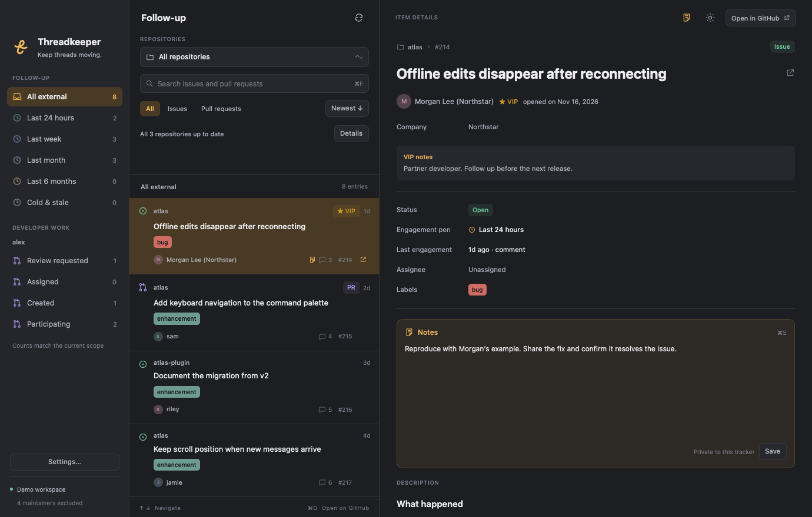

# Threadkeeper

**Keep the conversation moving.**



[Animated tour](docs/screenshots/threadkeeper-tour.gif) · [Screenshots](docs/screenshots/README.md)

A native Rust/Rune macOS app for following GitHub issues and pull requests across your own and external repositories. The embedded Rust backend uses PowerSync Native with local-only storage. GitHub access is read-only; notes and configuration stay local.

## Run

```sh
sh desktop-rune/scripts/launch.sh
```

Building requires Rust 1.99.1, Python 3 and Xcode command-line tools. Open the packaged app at `desktop-rune/dist/Threadkeeper.app`. No Node or web server is needed; the former web UI has been retired.

On first launch, follow the blocking GitHub setup screen to create and paste a read-only fine-grained token. The app validates it and stores it in `~/.config/threadkeeper/credentials.json` with owner-only permissions. An explicit `GITHUB_TOKEN` environment variable also works; GitHub CLI credentials are not used.

## Configure

New installs start with empty repository and maintainer lists. Team rosters are shared separately in a private repository and imported through Settings; they are never bundled in release builds. See [GitHub distribution](docs/RELEASING.md) for CI releases and the private configuration workflow.

Open **Settings…** with Command + comma. Repositories, Maintainers and VIPs each support JSON import, editing and live file reload.

Repositories can belong to any GitHub organization your account can read. Optional **Include terms** match any term in the issue or PR title only, ignoring case. Use comma-separated terms in Settings; leave empty to include everything. Old files with repository groups still import, but groups are ignored and omitted when saved.

```json
{
  "repositories": [
    { "name": "powersync-ja/powersync-js", "enabled": true },
    { "name": "TanStack/db", "enabled": true, "includeTerms": ["powersync", "journeyapps"] }
  ]
}
```

Filtering happens locally in Rust. Repository listings are still fetched; nonmatching entries are hidden and skipped for discussion polling. Previously included PRs continue receiving merge updates. Cached entries are re-evaluated when terms change, and saved notes are preserved. Descriptions, comments, labels and code diffs are not searched.

VIPs have GitHub profiles, optional full name, company, and freeform notes and a choice of Gold star, Neon, Outline, Subtle tint or Badge only card highlights. See [vips.example.json](vips.example.json).

The app stores its database and configuration in `~/Library/Application Support/Threadkeeper`. Existing checkout databases in `data/tracker.sqlite` can still be imported once, read-only, into an empty desktop database. Repository groups remain only as an unused legacy storage column for import compatibility.

See [desktop documentation](desktop-rune/README.md) for controls, authentication, configuration paths and verification; [tracker-core](tracker-core/README.md) describes the reusable backend.

## Developer work

Use the Developer work sidebar section for a selected maintainer’s review requests, assignments, authored items, and conversations across all enabled repositories. Choose and remember a profile in Settings → Developer work. Reason badges and highlighted contributions identify the selected developer; notes are shared with Follow-up. See [desktop documentation](desktop-rune/README.md#developer-work) for scope, sorting, history, and search limitations.

## Verify

```sh
cargo test --workspace
cargo build -p threadkeeper
```

Existing installs retain their previous `PowerSync Tracker` data folder and `powersync-workspace` credentials file when the new locations do not exist. No reset or token re-entry is needed.

Legacy `customers.json` files and `customers` arrays still load. `company` and legacy `organization` populate the separate Company field. Previously saved notes remain unchanged; text is never guessed or moved out of Notes. Existing installs keep their active file path. New files use `vips.json` with a `vips` array. Notes appear in Settings and the item details, never on cards.
